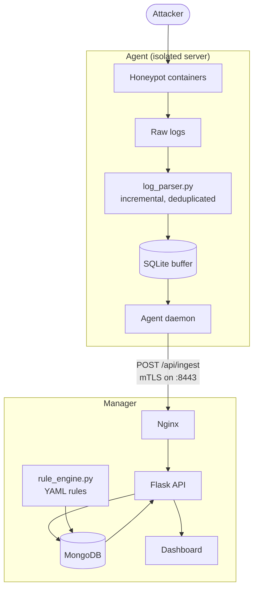
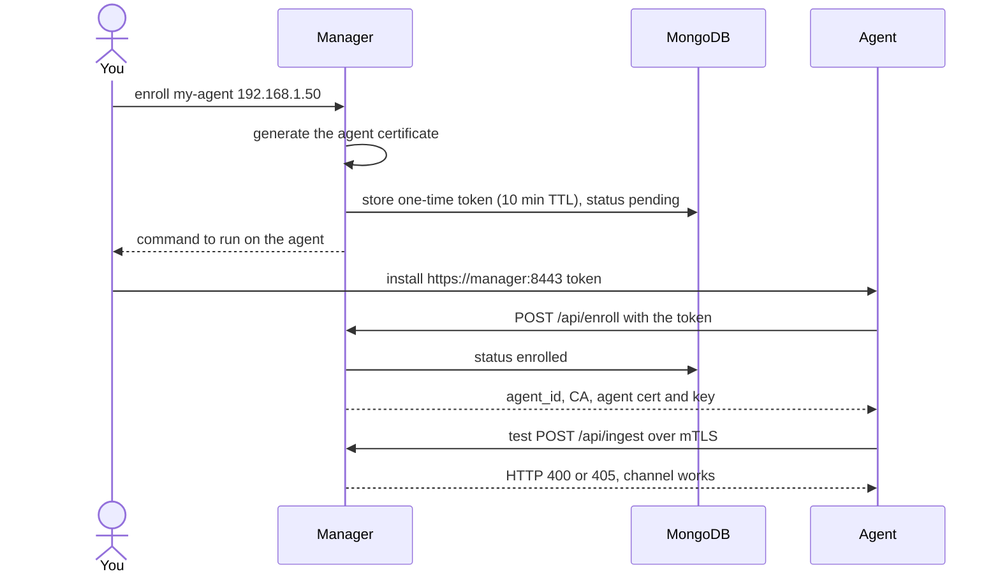
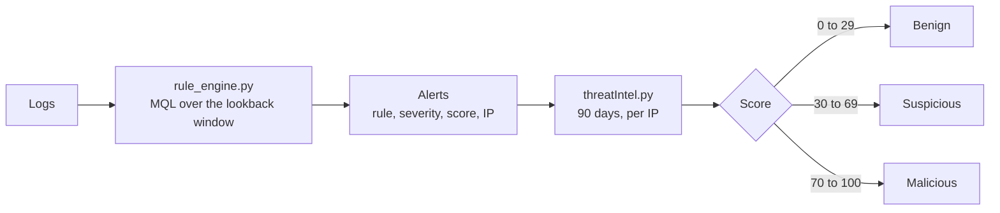

Most honeypots give you a wall of logs. [Melissae](https://github.com/ilostmypassword/Melissae-Honeypot-Framework) is my attempt at something more useful: **a fleet of decoys, a verdict on every attacker, and an (optional) AI analyst that explains what just happened.**

This article is the guide I wish I had written earlier. It walks through a complete v2.7 deployment (one manager, one agent), and explains what is going on under the hood so you know what you are running. Everything here comes from the project's [README](https://github.com/ilostmypassword/Melissae-Honeypot-Framework) and the [official documentation](https://melissae-documentation.readthedocs.io/en/latest/overview.html), which remain the source of truth.

<div class="note">

Melissae deliberately exposes weak services and, optionally, a **real vulnerability**. Deploy agents on dedicated servers, properly isolated from your production infrastructure.

</div>

## What you are about to deploy

Melissae is a distributed, modular honeypot framework built to emulate real-world network services. The pieces:

- **Manager / agent fleet.** Agents run the decoys and push what they see; the manager stores, analyses and displays everything. Deploy agents anywhere, manage them from a single hive.
- **Zero-trust by default.** Every agent talks to the manager over mutual TLS (ECDSA P-384), enrolled with one-time tokens.
- **Rule-based scoring.** 14 declarative YAML detection rules rate each IP from 0 to 100: benign, suspicious or malicious.
- **Real-time dashboard.** Live topology, GeoIP attack map, kill-chains, log search with logical operators, STIX 2.1 export, and a `Ctrl/⌘+K` command palette.
- **7 honeypot modules.** Web (Nginx/Apache), SSH, FTP, Telnet, Modbus/ICS and MQTT, plus CVE-specific decoys.
- **Inspektor AI.** An optional threat analyst on AWS Bedrock and LangChain: chat with your hive, export PDF briefings.

## How it fits together

The **manager** centralizes MongoDB, the Flask API, the dashboard, the alerting engine and agent monitoring. It does not run honeypots. The **agents** run the decoy modules, parse their logs locally into normalized JSON and push the result to the manager.



Two flows matter when you open firewalls later:

| Direction         | Channel        | Port | Purpose                              |
| ----------------- | -------------- | ---- | ------------------------------------ |
| Agent → Manager   | HTTPS + mTLS   | 8443 | Log ingestion (`POST /api/ingest`)   |
| Agent → Manager   | HTTPS (token)  | 8443 | Enrollment (`POST /api/enroll`)      |
| Manager → Agent   | HTTPS + mTLS   | 8444 | Health polling and remote commands   |

Agents **push** batches of up to 500 entries every 10 seconds. If the manager is unreachable, logs pile up in a local SQLite buffer (up to 512 MB) and the agent retries with exponential backoff, up to 5 minutes. The manager **pulls** each agent's health once a minute.

Melissae ships an embedded PKI, so you need no external tooling: an ECDSA P-384 CA valid for 10 years, one-year certificates for the manager and every agent, CRL-based revocation, and one-time enrollment tokens (64 hex characters, **10-minute TTL**). Nginx terminates mTLS on `:8443` and tells the API which agent is talking.

## Prerequisites

Both the manager and the agent must run a **Debian-based** distribution (Debian, Ubuntu) and you need `sudo` on both, because the installers configure system services (Docker, SSH, cron).

You do not have to prepare anything else. The manager installer pulls `curl`, `cron`, `openssl`, `apache2-utils`, `python3-pymongo`, `python3-yaml` and Docker CE with the Compose plugin if missing. The agent installer does the same for `jq`, `python3`, [uv](https://docs.astral.sh/uv/) and Docker.

## Step 1: the manager

Clone the repository on the manager server and start the interactive console:

```bash
git clone https://github.com/ilostmypassword/Melissae.git
cd Melissae/manager/ && chmod +x melissae-manager.sh
./melissae-manager.sh
```

Everything else happens inside that console:

```text
manager [0 active] > install
```

The installer walks you through several decisions:

1. **System packages**, installed via `apt-get`.
2. **PKI initialization.** It asks for the Certificate Authority identity:

   ```text
   CA Common Name [manager.local CA]:
   CA Organization (optional, leave blank to omit):
   ```

   This common name shows up in **every** TLS certificate. Pick a neutral one: a CA literally named "honeypot" defeats the point.
3. **Manager certificate.** It detects the machine's IP and hostname, then asks for the public FQDN or IP. The certificate covers that name, the detected IP, `localhost` and `127.0.0.1`.
4. **Dashboard credentials.** A username (default `melissae`) and a password, stored with bcrypt in `dashboard/conf/htpasswd`.
5. **Inspektor (optional).** Answer `N` for now; you can enable it later.
6. **Cron jobs.** Three scheduled tasks are installed (see [Housekeeping](#housekeeping)).

Once it is done, add your user to the `docker` group so you can drive containers without `sudo`:

```bash
sudo usermod -aG docker $USER
newgrp docker
```

Then start the stack:

```text
manager [0 active] > start
```

This brings up three containers:

| Container            | Port                        | Role                                                     |
| -------------------- | --------------------------- | -------------------------------------------------------- |
| `melissae_mongo`     | `127.0.0.1:27017`           | MongoDB data store (local only)                          |
| `melissae_api`       | `127.0.0.1:5000`            | Flask REST API (local only)                              |
| `melissae_dashboard` | `0.0.0.0:443`, `0.0.0.0:8443` | Nginx: dashboard on `:443`, mTLS ingestion on `:8443`  |

MongoDB and the API are bound to localhost and are never exposed. Only Nginx faces the network.

## Step 2: enroll and install an agent

Enrollment is a two-step handshake. First, ask the manager for a token and a certificate for a named agent:

```text
manager [3 active] > enroll my-agent 192.168.1.50
```

The manager validates the name, generates the agent's certificate, creates the one-time token and registers the agent as `pending`. Here is the whole handshake:



The manager prints the exact command to run on the agent:

```text
[✓] Enrollment token generated (expires in 10 minutes)

   Run this on the agent:

   ./melissae-agent.sh install https://<manager-ip>:8443 a1b2c3d4...
```

Now, on the **agent server**:

```bash
git clone https://github.com/ilostmypassword/Melissae.git
cd Melissae/agent/ && chmod +x melissae-agent.sh
./melissae-agent.sh
```

```text
agent:? [0 active] > install https://<manager-ip>:8443 <token>
```

<div class="note">

**Read this before you hit enter.** The agent installer randomizes your SSH port to a value between 20000 and 30000 so the real SSH daemon is out of the way of the honeypot on port 22. The new port is displayed at the end of the installation. **Note it down**, you will need it to reconnect.

</div>

The installer then:

- installs the system packages, uv, a Python virtual environment (`requests`, `pyyaml`) and Docker;
- **enrolls** with the token (`POST /api/enroll`), saving the CA, agent certificate and key in `agent/certs/` with the key at mode 600. The agent flips from `pending` to `enrolled`;
- writes `daemon/config.yml` with the manager URL, certificate paths, push interval and buffer size;
- sends a test `POST /api/ingest` with the new certificates. An HTTP 400 or 405 answer confirms the mTLS channel works;
- swaps the SSH port, and asks whether to restart SSH immediately.

## Step 3: choose your decoys

All native modules are enabled by default and the CVE module is disabled. Review them before starting:

```text
agent:my-agent [0 active] > list
agent:my-agent [0 active] > disable modbus
agent:my-agent [0 active] > enable cve-2026-24061
```

| Module     | Port | What it pretends to be                                       |
| ---------- | ---- | ------------------------------------------------------------ |
| Web        | 80   | Nginx proxy in front of two Apache servers                   |
| SSH        | 22   | Ubuntu 24.04 + OpenSSH, weak credentials by design           |
| FTP        | 21   | vsftpd on Debian, weak credentials by design                 |
| Telnet     | 23   | `inetutils-telnetd` on Ubuntu 24.04                          |
| Modbus/ICS | 502  | A Siemens S7-1200 or Schneider M340 PLC                      |
| MQTT       | 1883 | Eclipse Mosquitto                                            |
| CVE        | 23   | A real, exploitable vulnerability (CVE-2026-24061)           |

A few details I like:

- The **Modbus** module randomizes serial numbers and firmware versions on every startup, logs every function code, and treats write attempts as high severity: someone tampering with a PLC is not just scanning.
- Credentials and content are yours to change: `modules/ssh/Dockerfile`, `modules/ftp/Dockerfile`, `modules/telnet/Dockerfile`, and your own site under `modules/web/server`.
- Modules binding the same host port cannot run together. `telnet` and `cve-2026-24061` both use port 23, so the CLI rejects that combination.

<div class="note">

The CVE module reproduces a **real vulnerability**: GNU Inetutils `telnetd` up to 2.7 lets an attacker log in as root without credentials by injecting `-froot` as the `USER` environment variable (CVE-2026-24061, CVSS 9.8). Run it only on machines that are fully isolated. It is confined with `pids_limit: 64`, `mem_limit: 128m` and a dedicated Docker network (`172.30.0.0/24`), but that is a safety net, not a license to be careless.

</div>

Then start the honeypot containers and the agent daemon, which runs as a plain background process on the host:

```text
agent:my-agent [0 active] > start
```

## Step 4: open the dashboard

Point your browser at the manager:

```text
https://<manager-ip>/
```

Log in with the credentials you chose during `install`. Your browser will complain about the certificate: it is signed by Melissae's internal CA, so this is expected. Import `pki/ca/ca.crt` into your trust store to silence it. Port `8443` is reserved for agent traffic, never use it from a browser.

Check that the agent registered:

```text
manager [3 active] > agents
```

An agent goes through these states:

| Status                                  | Meaning                                                      |
| --------------------------------------- | ------------------------------------------------------------ |
| `pending`                               | Token generated, the agent has not enrolled yet              |
| `enrolled`                              | Enrollment done, the manager has not polled it yet           |
| `healthy` / `degraded` / `unreachable`  | Written by the health poller, which runs every minute        |

Expect `healthy` about a minute after starting the daemon. Note that the status comes from the poller, **not** from log pushes.

### If an agent stays unreachable

Two flows must be open: **agent → manager** on TCP `8443`, and **manager → agent** on TCP `8444`, towards the agent's *public* IP. On cloud providers (AWS security groups, Lightsail firewall), allow the manager's **public** IP on port `8444`, not its private one. The honeypot ports themselves (22, 21, 23, 1883, 502, 80) are the ones you want open to the internet.

Run the poller by hand on the manager to see the exact error:

```bash
python3 scripts/health_poller.py
```

`timed out` means a firewall is dropping the traffic. `Connection refused` means the path is open but the agent daemon is stopped: run `start` on the agent.

## How an attacker gets a score

This is the part that turns logs into a story. Since v2.2, detection is **rule-based**: each rule is a small YAML file in `rules/`, evaluated on a schedule by `rule_engine.py`.

```yaml
id: MLS008
name: SSH brute-force attempt
severity: high
schedule: "*/1 * * * *"
lookback: 1m
mql: 'protocol:ssh AND action:Failed'
group_by: ip
threshold: 3
score: 40
tags: [brute-force, credential-access]
mitre: [T1110]
```

Read it out loud: every minute, look at the last minute of logs, find SSH events matching the query, group them by IP, and if an IP has at least 3 of them, raise a `high` alert worth 40 points, mapped to MITRE ATT&CK T1110.

The `mql` field uses **MQL**, the Melissae Query Language, the same one as the dashboard search bar. It supports field-scoped terms (`protocol:ssh`, `ip:1.2.3.4`, `user:root`, `cve:CVE-2026-24061`), free text, `AND` / `OR` / `NOT`, parentheses and quoted phrases:

```text
protocol:ftp AND action:"Login failed"
protocol:modbus AND action:write
ip:192.168.1.10 AND NOT action:successful
```

Fourteen rules ship with v2.7. A sample of what they cover:

| Rule   | Detection                                   | Severity | Score |
| ------ | ------------------------------------------- | -------- | ----- |
| MLS001 | Telnet CVE-2026-24061 auth bypass           | critical | 85    |
| MLS007 | Modbus write operation (ICS tampering)      | high     | 45    |
| MLS008 | SSH brute-force                             | high     | 40    |
| MLS009 | Post-compromise SSH command (`wget`, `curl`, `chmod`) | critical | 70 |
| MLS010 | Successful SSH login                        | critical | 70    |
| MLS012 | Nmap scan (user-agent based)                | low      | 5     |
| MLS014 | MQTT publish or wildcard subscription       | high     | 40    |

Every matching group becomes an **alert**. Every minute, `threatIntel.py` aggregates the alerts of the last 90 days per IP into a verdict:



Each matching rule contributes:

```text
contrib(rule) = rule.score + 5 · log2(max(1, rule.count))
score(ip)     = min(100, Σ contrib(rule))
```

The logarithm is the clever bit: a noisy low-severity rule firing again and again slowly pushes an IP up, but cannot catapult it straight into "malicious". For example, an IP that trips MLS008 eight times scores `40 + 5·log2(8) = 55`, which is suspicious. If it then logs in successfully (MLS010, +70), it hits the cap of 100.

| Score  | Verdict    | Typical behaviour                                              |
| ------ | ---------- | -------------------------------------------------------------- |
| 0–29   | Benign     | Seen in the logs, never matched a rule, or only passive scans  |
| 30–69  | Suspicious | Active scanning, failed authentication, reconnaissance         |
| 70–100 | Malicious  | Compromise, post-exploitation, ICS tampering, confirmed CVE exploitation |

IPs that appear in the logs without ever firing a rule still get a `benign` entry flagged `passive: true`, so the dashboard reflects every IP the hive has actually seen. And because every point traces back to a named rule, the scoring is auditable. To add a detection, drop a new `MLSxxx.yml` in `rules/` with a unique `id`, a sensible `score`, an `mql` query, then `restart` the manager. As a rule of thumb, keep noisy signals in the 5 to 20 range and reserve 50 to 70 for high-confidence single events such as CVE exploitation or ICS writes.

## Optional: meet Inspektor

**Inspektor** is the AI threat analyst. It is disabled by default and needs AWS Bedrock credentials with model access. Enable it whenever you want from the manager console:

```text
manager [3 active] > inspektor
```

It prompts for your AWS keys, region and Bedrock model id, writes them to the manager `.env` file (mode 600), then builds and starts a fourth container, `melissae_inspektor`. It investigates the live honeypot data through **read-only** tools, answers in a built-in chat and produces SOC-ready briefings you can export to PDF. It answers strictly from retrieved data. The service listens on port `8088` on the internal Docker network only and is reached through the manager API proxy, never exposed externally.

## Housekeeping

Three cron jobs are added to the manager during `install`:

| Schedule      | Script                    | Purpose                                                                       |
| ------------- | ------------------------- | ----------------------------------------------------------------------------- |
| Every minute  | `scripts/threatIntel.py`  | Runs the rule engine, recalculates verdicts, adds passive entries             |
| Every minute  | `scripts/health_poller.py`| Polls agent health endpoints                                                  |
| Every 3 hours | `scripts/purgeLogs.py`    | Recycles idle benign threat documents and trims logs older than 30 days       |

The purge is non-destructive: recycled benign documents are rebuilt from the logs on the next run.

## Wrapping up

In a handful of commands you get a manager, an enrolled agent, a set of believable decoys, scored attackers and a dashboard to follow them. Some things worth doing next:

- put a believable website under `modules/web/server` and change the default credentials;
- watch the dashboard for a few days, then write your own rules for what you see;
- export the threat data as STIX 2.1 and feed it to your other tools;
- come back to the [documentation](https://melissae-documentation.readthedocs.io) for the dashboard pages, the CLI reference and the contributing guide, if you want to write a module for a new CVE.

Melissae is [open source](https://github.com/ilostmypassword/Melissae-Honeypot-Framework) under GPL-3.0, and contributions are welcome. If you deploy it, I would love to hear what hits your decoys first.
