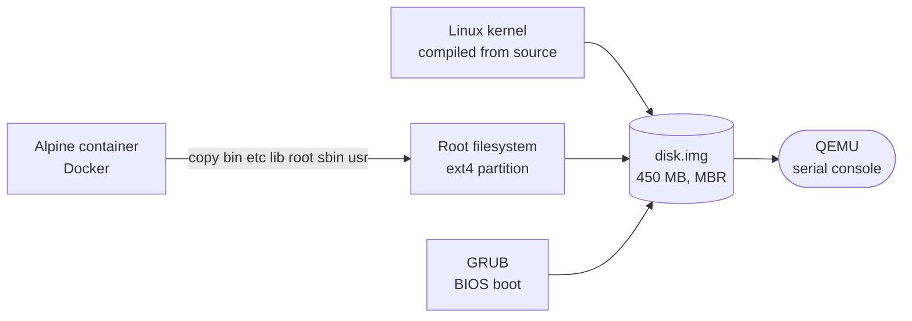
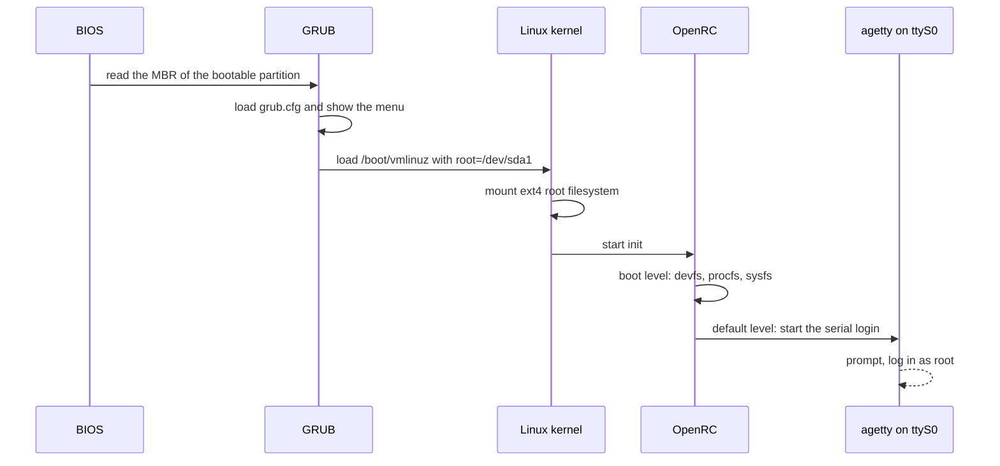

There is no better way to understand what a Linux system actually *is* than to assemble one yourself. [MiniLinux-From-Scratch](https://github.com/ilostmypassword/MiniLinux-From-Scratch) is a short tutorial that builds a **small, self-contained distribution derived from Alpine Linux**: a kernel you compile, a root filesystem borrowed from a Docker image, a bootloader, and a single disk image you can boot in QEMU.

The method is intentionally generic. Nothing in it is specific to Alpine, so the same steps can be adapted to another base distribution. This post follows the repository's README and adds the reasoning behind each step.

<div class="note">

Several commands run as root (`losetup`, `mount`, `grub-install`) and operate on block devices. Double-check the loop device number before you format or install anything, and never point them at a real disk.

</div>

## The big picture

A Linux machine needs surprisingly few things to boot: a kernel, a root filesystem with an init system, and a bootloader that glues them together. We will build each piece separately and assemble them inside one raw disk image.



## Requirements

Two things are needed before you start:

- **A compiled Linux kernel.** It is the core of the system, responsible for hardware and resource management. The next section compiles one.
- **Docker.** It is used as a convenient way to obtain a ready-made Alpine userland, not as a runtime for the final system.

You will also use `parted`, `losetup`, `mkfs.ext4`, GRUB and QEMU on the host. On a Debian-based host, the BIOS flavour of GRUB (the `i386-pc` modules used later) may have to be installed separately.

## Compiling the kernel

Download the kernel archive of your choice from [kernel.org](https://www.kernel.org/), extract it, and from its directory run:

```bash
make defconfig
scripts/config --set-val CONFIG_BPF_SYSCALL y
scripts/config --set-val CONFIG_BPF_LSM y
scripts/config --set-val CONFIG_DEBUG_INFO_BTF y
scripts/config --set-val CONFIG_FUNCTION_TRACER y
scripts/config --set-val CONFIG_DYNAMIC_FTRACE y
scripts/config --set-val CONFIG_DYNAMIC_FTRACE_WITH_REGS y
make olddefconfig
make -j$(nproc)
```

`make defconfig` generates a sensible default configuration for your architecture. Every `scripts/config` line and the `make olddefconfig` that follows are **optional**. They switch on eBPF, BTF type information and the function tracer, which is what you want if you plan to experiment with tracing and eBPF programs in the guest (this is also why the Alpine image later receives `clang`, `llvm`, `bpftool` and `libbpf`). If you only want a system that boots, skip them.

`make -j$(nproc)` then builds the kernel on every available core. The result is the compressed image `arch/x86/boot/bzImage`.

## Preparing the disk image

The whole system will live in a single file that behaves like a hard disk.

**Create an empty 450 MB file:**

```bash
truncate -s 450M disk.img
```

**Create a BIOS (MBR) partition table in it:**

```bash
/sbin/parted -s ./disk.img mktable msdos
```

**Add one primary ext4 partition that fills the whole image:**

```bash
/sbin/parted -s ./disk.img mkpart primary ext4 1 "100%"
```

**Flag it as bootable**, so the BIOS knows where to look:

```bash
/sbin/parted -s ./disk.img set 1 boot on
```

**Expose the image and its partitions through a loop device.** A loop device lets the kernel treat a regular file as a block device:

```bash
sudo losetup -Pf disk.img
```

**Find out which device you got:**

```bash
losetup -l
```

From here on, `X` stands for the number of your loop device (for example `/dev/loop0`, whose first partition is `/dev/loop0p1`).

**Format the first partition as ext4, then mount it:**

```bash
sudo mkfs.ext4 /dev/loopXp1
mkdir -p /tmp/my-rootfs
sudo mount /dev/loopXp1 /tmp/my-rootfs
```

Writing into `/tmp/my-rootfs` now writes into the partition inside `disk.img`.

## Populating the root filesystem with Alpine

This is the cheap trick that makes the whole tutorial short: instead of building a userland by hand, we start an Alpine container with the mounted partition shared as a volume, configure it, and copy it over.

```bash
docker run -it --rm -v /tmp/my-rootfs:/my-rootfs alpine
```

Everything below happens **inside the container**.

**Install the init system, basic utilities and a toolchain:**

```bash
apk add openrc util-linux build-base clang llvm bpftool libbpf-dev linux-headers
```

`openrc` is Alpine's init system and `util-linux` brings the usual tools. The rest (`build-base`, `clang`, `llvm`, `bpftool`, `libbpf-dev`, `linux-headers`) turns the guest into a place where you can compile C and eBPF programs.

**Give the system a serial console.** QEMU will run without a screen, so the login prompt has to appear on the first serial port:

```bash
ln -s agetty /etc/init.d/agetty.ttyS0
echo ttyS0 > /etc/securetty
rc-update add agetty.ttyS0 default
rc-update add root default
```

**Set a root password:**

```bash
passwd root
```

**Mount the pseudo filesystems at boot.** `/dev`, `/proc` and `/sys` are virtual: they expose devices, processes and kernel state:

```bash
rc-update add devfs boot
rc-update add procfs boot
rc-update add sysfs boot
```

**Copy the system to the mounted partition:**

```bash
for d in bin etc lib root sbin usr; do tar c "/$d" | tar x -C /my-rootfs; done
```

Piping `tar` into `tar` preserves permissions, ownership and symlinks, which a plain `cp` would not do as reliably.

**Create the mount points the kernel and init expect, then leave the container:**

```bash
for dir in dev proc run sys var; do mkdir /my-rootfs/${dir}; done
exit
```

These directories are empty on purpose: they are only mount points, filled at runtime.

## Installing GRUB

Back on the host, the partition is still mounted at `/tmp/my-rootfs`.

**Optionally, edit the welcome message** shown before the login prompt:

```bash
sudo vim /tmp/my-rootfs/etc/issue
```

**Create the boot directory and copy the kernel you compiled** (run the `cp` from the kernel source directory):

```bash
sudo mkdir -p /tmp/my-rootfs/boot/grub
sudo cp linux/arch/x86/boot/bzImage /tmp/my-rootfs/boot/vmlinuz
```

**Write the GRUB configuration** in `/tmp/my-rootfs/boot/grub/grub.cfg`:

```text
serial
terminal_input serial
terminal_output serial
set root=(hd0,1)
menuentry "MiniLinux-From-Scratch" {
  linux /boot/vmlinuz root=/dev/sda1 console=ttyS0
}
```

Reading it line by line:

- `serial`, `terminal_input serial` and `terminal_output serial` make GRUB itself talk over the serial port, since there is no display.
- `set root=(hd0,1)` tells GRUB where its files are: first disk, first partition.
- `linux /boot/vmlinuz ...` loads the kernel. `root=/dev/sda1` is the partition to mount as `/` and `console=ttyS0` sends kernel messages and the console to the serial port.

There is no initramfs here. The kernel mounts the root partition itself, which is possible because a default configuration compiles the needed drivers and ext4 straight into the kernel.

**Install GRUB for BIOS boot**, directly on the loop device (the whole device, not the partition):

```bash
sudo grub-install --directory=/usr/lib/grub/i386-pc --boot-directory=/tmp/my-rootfs/boot /dev/loopX
```

This writes the first-stage loader into the image's boot sector and places the rest under the `boot-directory` you pointed it at.

## Unmounting and booting

**Flush and release everything:**

```bash
sudo umount /tmp/my-rootfs
sudo losetup -d /dev/loopX
```

Skipping this step risks booting a partially written filesystem.

**Boot the image in QEMU:**

```bash
qemu-system-x86_64 -hda disk.img -nographic
```

`-nographic` disables the graphical window and wires the guest's serial port to your terminal, which matches the `console=ttyS0` we configured.

## What happens at boot

Everything you just assembled plays its part, in this order:



When the `login:` prompt shows up in your terminal, log in as `root` with the password you set. To leave QEMU in `-nographic` mode, press `Ctrl+A` then `X`.

## Wrapping up

You now have a bootable Linux system in a single 450 MB file, and you know where each piece comes from: the kernel from source, the userland from an Alpine container, and the glue from GRUB. A few directions worth exploring from here:

- change the base: swap Alpine for another distribution's container image and see what breaks;
- trim the kernel configuration instead of starting from `defconfig`, and watch the image shrink;
- use the preinstalled toolchain to write and load a first eBPF program inside the guest;
- script the whole procedure so a fresh image is one command away.

The project is on [GitHub](https://github.com/ilostmypassword/MiniLinux-From-Scratch). Issues and suggestions are welcome.
